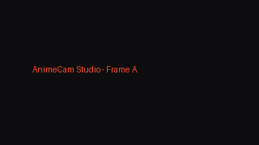

# 🥷 AnimeCam Studio

[](https://github.com/animecam-studio/animecam/actions)
[](https://www.python.org/)
[](https://opensource.org/licenses/MIT)
[](https://github.com/astral-sh/ruff)
[](https://pytest.org/)

> **AnimeCam Studio** is an open-source, real-time virtual webcam effects studio built in Python with **OpenCV**, **MediaPipe**, **NumPy vectorization**, **pyvirtualcam**, and **CustomTkinter**.
>
> Broadcast real-time anime visual effects, shadow clones, glowing iris shaders, and stealth background healing directly into Zoom, Discord, Google Meet, and OBS with **locked 30 FPS on standard consumer CPUs**.

---

<p align="center">
  
</p>

---

## ⚡ Core Features

- **Multi-Seal Hand Combo FSM (`gestures.py`):** Real-time single and two-handed gesture detection via MediaPipe Hands (21 landmarks). Employs scale-invariant Euclidean distance ratios (wrist-to-MCP normalized) and a sliding temporal window (`collections.deque`) to trigger jutsu combos without depth distortion.
- **Continuous Background Healing Invisibility (`invisibility.py`):** Real-time neural selfie segmentation coupled with Exponential Moving Average (EMA) blending. Non-person pixels adapt dynamically to room illumination changes, enabling seamless invisibility cloak effects.
- **Ring-Buffer Shadow Clones (`clones.py`):** Pre-allocated $O(1)$ ring buffer (`collections.deque(maxlen=24)`) storing `(frame, mask)` pairs. Renders time-delayed shadow clones behind your live silhouette with vectorized alpha compositing.
- **Iris-Locked Dojutsu Overlay (`eyes.py`):** Sub-pixel tracking of iris landmarks (`468`, `473`) using MediaPipe FaceMesh. Mathematically scales, rotates, and alpha-blends transparent BGRA shaders (Sharingan, Rinnegan, Sage Mode) onto your eyes in real time.
- **Hardware-Decoupled Dark-Mode Dashboard (`studio_app.py`):** Production CustomTkinter UI (`#0D0D0F` dark mode with `#FF4925` jutsu accents) featuring live FPS telemetry, manual effect overrides, slider parameter tuning, and a hardware privacy kill-switch.

---

## 🥋 Ninja Jutsu Combo Cheatsheet

Perform these hand signs in front of your camera to trigger jutsu in real time:

| Jutsu Technique | Hand Sign / Combo Sequence | MediaPipe Landmark Geometry | Effect Triggered |
| :--- | :--- | :--- | :--- |
| **Shadow Clone Jutsu** *(Kage Bunshin)* | **`CLONE_CROSS` (十字)** | Two hands crossing index fingers perpendicularly ($45^\circ \le \theta \le 135^\circ$) | Spawns delayed translucent clones flanking behind you |
| **Invisibility Cloak** *(Meisaigakure)* | **`TIGER` $\rightarrow$ `RAM`** | Index + Middle extended together, followed by Ram seal within 2s | Erases user with continuous healed background plate |
| **Dojutsu Eyes** *(Sharingan)* | **`TIGER` (Hold $\ge 14$ frames)** | Hold Tiger seal steadily or sequence `BOAR` $\rightarrow$ `TIGER` | Locks rotating animated Sharingan/Rinnegan onto irises |
| **Privacy Kill-Switch** | **`[Space]` Key / UI Button** | Hardware hotkey | Instantly cuts virtual camera to black and flushes memory |

---

## 🛡️ Production Systems & Safety Engineering

| Guardrail | Engineering Implementation | Benefit |
| :--- | :--- | :--- |
| **Zero Python Pixel Loops** | 100% Vectorized NumPy operations (`np.where`, broadcasting, 2D slice updates) | Prevents CPU bottleneck; achieves 30 FPS at 720p on CPU |
| **Lazy Inference Scheduling** | Hand gestures evaluated at 15 Hz cadence (odd frames); FaceMesh evaluated only when active | Cuts overall CPU consumption by ~40% |
| **Lock-Free Frame Decoupling** | CV pipeline isolated in a daemon thread; atomic pointer reference swap with UI | Eliminates UI micro-stutters and GUI thread freezing |
| **Hardware Release Guarantee** | `cv2.VideoCapture` and `pyvirtualcam.Camera` wrapped in Python Context Managers | Guaranteed camera release on exceptions or system interrupts |
| **Privacy Panic Button** | `Space` hotkey / UI button instantly blanks feed and flushes frame memory | Zero unmanaged frames in memory; instant privacy cutoff |
| **Clean Virtual Broadcast** | Local UI displays HUD and landmark debug telemetry; virtual webcam feed receives raw clean effects | Zero visual clutter in your actual video calls |

---

## 📐 Architecture Overview

```
                      +-----------------------+
                      | Physical Webcam (CV2) |
                      +-----------+-----------+
                                  |
                                  v
              +---------------------------------------+
              | SafeCamera Context Manager            |
              +-------------------+-------------------+
                                  | BGR Frame (30 FPS)
                                  v
+-------------------------------------------------------------------+
|               CV Engine Worker (Daemon Thread)                    |
|                                                                   |
|  [Frame Scheduler: Hands @ 15Hz | FaceMesh Lazy Execution]        |
|  [Vectorized Pipeline: Invisibility -> Clones -> Eye Shaders]     |
|                                                                   |
|  [Split Buffers]                                                  |
|   ├── Clean Effect Frame  --> pyvirtualcam (Virtual Webcam)       |
|   └── Telemetry/HUD Frame --> Atomic Pointer Swap (Local UI)      |
+---------------------------------+---------------------------------+
                                  |
                                  v
              +---------------------------------------+
              | CustomTkinter Dashboard (Main Thread) |
              +---------------------------------------+
```

---

## 🚀 Quickstart

### 1. Installation

```bash
# Clone the repository
git clone https://github.com/animecam-studio/animecam.git
cd animecam

# Create and activate virtual environment (Python 3.10, 3.11, or 3.12)
python -m venv .venv

# On Linux / macOS:
source .venv/bin/activate
# On Windows (PowerShell):
.venv\Scripts\Activate.ps1

# Install package in editable mode with dependencies
pip install -e .
```

### 2. Virtual Camera Setup

- **Windows:** Install [OBS Studio](https://obsproject.com/) (includes OBS Virtual Camera driver) or `Unity Capture`.
- **Linux:** Run the included safe setup script:
  ```bash
  sudo bash scripts/setup_v4l2_linux.sh
  ```
- **macOS:** Install the OBS macOS Virtual Camera plugin.

### 3. Launch AnimeCam Studio

```bash
# Launch default camera:
animecam

# Launch with custom resolution and device index:
animecam --device 0 --width 1280 --height 720 --fps 30

# Launch in synthetic test mode (without webcam hardware):
animecam --synthetic --no-virtual-cam
```

### CLI Arguments Reference

| Argument | Type | Default | Description |
| :--- | :--- | :--- | :--- |
| `--device` | `int` | `0` | Physical camera index. Set to `-1` for synthetic mode. |
| `--width` | `int` | `1280` | Target capture width in pixels. |
| `--height` | `int` | `720` | Target capture height in pixels. |
| `--fps` | `int` | `30` | Target frame rate. |
| `--no-virtual-cam` | `flag` | `False` | Run in standalone preview mode (disables virtual camera output). |
| `--synthetic` | `flag` | `False` | Force procedural synth test pattern feed (useful in headless/CI). |
| `--verbose`, `-v` | `flag` | `False` | Enable detailed debug logs. |

---

## 🧪 Running Tests & Quality Checks

```bash
# Run Ruff linting
ruff check src/ tests/

# Run unit tests across all suites
pytest -v
```

---

## 📜 License

Distributed under the **MIT License**. See [LICENSE](LICENSE) for more details.
